# ScopeFTP（Spring Boot + Tauri + Ant Design）

ScopeFTP 是一个文件上传/管理桌面应用：服务端 `ScopeFTP-server`，客户端 `ScopeFTP-client`。

- **ScopeFTP-server**：Spring Boot 3.3.5 / Java 21，提供文件上传、列表、下载、删除接口，**SQLite 本地持久化**（元数据/审计，无需安装数据库服务）+ 本地文件存储，可直接 Docker 或 systemd 部署到服务器
- **ScopeFTP-client**：Tauri 2 桌面应用（Rust + React 18 + TypeScript + Ant Design 5），FTP 式浏览服务器目录，**把文件拖进右侧即上传到当前目录**，可下载/删除
- **防伪验证**：每个请求都需要 `HMAC-SHA256` 签名 + 时间戳 + 一次性 nonce，配合设备绑定与限流，**没有 appSecret 的第三方无法调用接口，抓包也无法重放**

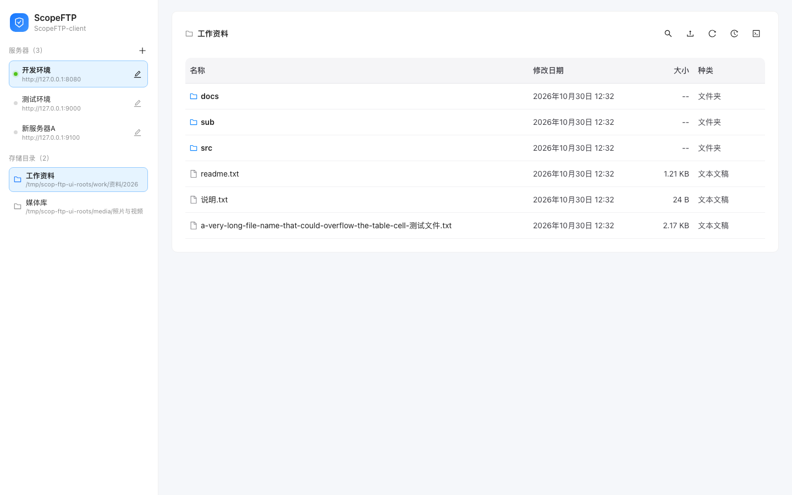

> 截图为浏览器预览模式（桌面客户端内不会出现「请使用桌面客户端运行」提示）。

## 功能特性

**服务端**

- 文件上传（**不限文件类型**、原始文件名清洗、**按当前浏览目录原名落盘**、重名自动加序号；>200MB 走**分片上传 + 断点续传**，分片 8MB、文件上限默认 5GB）
- 在存储根目录内**递归搜索**文件名，客户端可点结果直接跳到所在目录并高亮
- 文件分页列表（按文件名搜索）、按 id 或按路径下载（流式、响应头带 SHA-256）、按 id 或按路径删除
- 统一 JSON 信封 + 错误码（40000/40001/40003/40100/40101/40102/40300/40400/42900 …）
- **SQLite 本地持久化**：每个存储根的文件/设备元数据在 `<root>/.upload-meta/metadata.sqlite3`（WAL + 事务 + 内存只读索引），文件内容直接存在存储根目录；无需安装数据库，数据目录可直接挂载/备份。旧版 `files.json`/`devices.json` 启动时自动迁移并备份
- **FTP 式目录浏览**：客户端直接查看服务端存储根目录（`app.storage.roots[]`，默认 `./data`）的真实目录树；**在哪一级目录就把文件上传到哪一级**（原名落盘），并可下载/删除当前目录里的文件；文件可直接拖进窗口上传；列表为 **Finder 风格**（名称/修改日期/大小/种类），支持 ↑↓ 选择、Enter 或再次单击重命名、双击文件用本机默认应用打开、双击文件夹进入
- **多服务器管理**：客户端可保存多台服务器（添加/切换/编辑），每台独立设备号，配置 v2（`activeServerId` + `servers[]`）
- **操作审计日志（可客户端查看）**：所有客户端触发的 `/api/**` 请求（含成功/失败/签名失败/限流）写入服务端 JSONL + SQLite（`app.audit.dir`，默认 `./logs/audit`），记录 requestId、appKey、设备、IP、动作、路径、参数、耗时、状态等；客户端顶栏日志抽屉把连接验证/设备激活与上传/下载/删除/移动/编辑/解压/终端等实际操作合并展示，用「类型 / 操作 / 时间」筛选区分，不把目录列表、搜索等只读 API 请求混入日志视图；支持分页和完整详情；请求体脱敏截断，不记录密钥/签名/文件正文；响应头 `X-Request-Id` 可关联
- **拷贝 / 移动**：右键文件或目录「拷贝」原地生成副本（`xxx.txt` → `xxx_副本.txt`，目录 `abc` → `abc_副本`，重名 `_副本 (1)`）；「移动到…」弹出目录选择器，可切换存储根、浏览目录后确认移动，支持文件/目录与跨根，禁止覆盖和移动到自身子目录
- **在线编辑与 zip 解压**：右键文件可「在线编辑」（内置 **Monaco（VS Code 内核）**，按扩展名自动识别并手动切换语言高亮、Tab 缩进 **2/4 空格可选并记住**、⌘S/Ctrl+S 保存，原子覆盖原文件并可检测并发修改）；右键 `.zip` 可「解压」到同级同名目录，带 zip-slip/symlink/zip bomb 防护、重名自动加序号；若 zip 内只有唯一一层顶层目录包裹全部内容，会**自动剥掉这层**（如 `pkg/a.txt` → `压缩包/a.txt`），否则保持原目录结构
- **远程终端**：底部 VS Code 风格终端面板，命令**直接在输出区输入**（内联 `$` prompt、↑↓ 历史、Ctrl/⌘+L 清屏、点击输出区聚焦），支持 **Tab 路径补全**（目录补 `/`、文件补空格、多候选列出）；`cd` 会话内生效、输出截断/超时提示；右键文件/目录可选「在此打开终端」——文件定位到所在目录、目录定位到该目录，工具栏终端定位到当前目录；**只能访问配置的 `app.storage.roots` 内目录**——`cd /tmp`、`cat /etc/...`、根外重定向等越界命令会被拒绝；内置高危命令护栏（`rm -rf /`、`sudo`、`mkfs`、关机、fork bomb、`curl | sh` 等）——命中即拒绝执行并弹警告说明原因；可用 `UPLOAD_TERMINAL_ENABLED=false` 关闭
- **右键菜单**：目录/文件行右击可「重命名」「删除」；重命名直接在行内名称单元格编辑（回车/失焦保存、Esc 取消），支持文件与目录（严格同根校验、不覆盖同名）；删除支持文件与空目录
- **多存储根目录**：服务端可配置多个存储根（`app.storage.roots[]`，`id`/`name`/`path`；也可用 `UPLOAD_STORAGE_ROOTS="work=/a,media=/b"`），客户端左侧「存储目录」切换；所有浏览/上传/下载/删除/搜索都严格限制在选中的根内，跨根/根外操作一律拒绝；单根 `root-dir` 已删除，roots 为空启动失败
- **存储目录可配置且严格受限**：`app.storage.roots[]` 指定服务器存储根目录（默认一个 `default` 根指向 `./data`），服务端只能在配置的根内读写删（拒绝 `../`、绝对路径、符号链接逃逸、跨根），客户端无法指定服务器路径
- 全链路测试 263 个（JUnit 5 + MockMvc + 固定 Clock 签名向量 + SQLite MetaStore 并发/重启/迁移 + 存储目录约束 + FTP 式按目录上传/路径下载删除 + 分片上传/续传/搜索/限流 + 多存储根隔离 + 重命名/删空目录 + 解压剥层/拷贝移动 + 审计 SQLite/查询接口测试）

**客户端**

- **左右两栏主界面**：左边是**多台服务器列表**（添加/切换/铅笔编辑；服务器详情、验证连接、激活设备都在编辑页）+「存储目录」切换；右边是服务器目录浏览器（面包屑、刷新、上传按钮；**支持把文件/多文件直接拖进右侧上传到当前目录**，文件行可下载/删除）
- **VSCode 式快速查找（⌘P / Ctrl+P）**：命令面板式浮层，同时搜索文件夹与文件，显示名称+相对路径与类型图标，↑↓ 选择、Enter 打开（文件跳到所在目录并高亮、目录直接进入）、Esc 关闭；只搜当前存储根
- 设置从左侧进入，点左侧服务器（含当前服务器）即可回到目录：服务器地址、AppKey/AppSecret（可选）、设备名称、验证连接、激活设备、只读显示服务端存储目录
- **AppKey / AppSecret 默认内置在客户端**（构建时可覆盖），也可在设置页按服务器单独填写；留空时使用内置默认值
- **所有网络请求与签名都在 Rust 侧完成**，WebView 拿不到 appSecret
- 上传前先算 SHA-256、流式上传并回传进度；下载边写盘边校验 SHA-256
- **操作 / 连接日志（合并视图）**：顶栏时钟图标打开右侧抽屉，连接验证/设备激活与上传/下载/删除/移动/编辑/解压/终端等实际操作按时间混排；目录浏览、搜索等只读请求仍保留在底层审计库，但不进入日志视图。支持类型/操作/时间范围筛选、服务端分页；列表按「设备/IP → 操作内容 → 时间 → 操作」展示，终端命令与文件路径/重命名/拷贝/移动目标直接显示，不再显示接口路径、结果和耗时；详情保留 requestId、body/终端命令/IP/设备等诊断字段；只查当前登录 appKey 的记录
- Ant Design 5 中文语言包 + 自定义主题 token

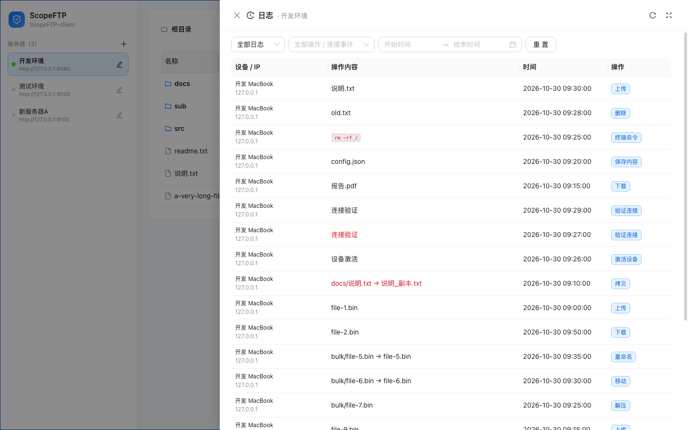

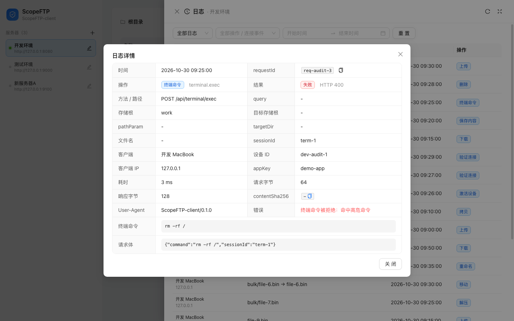

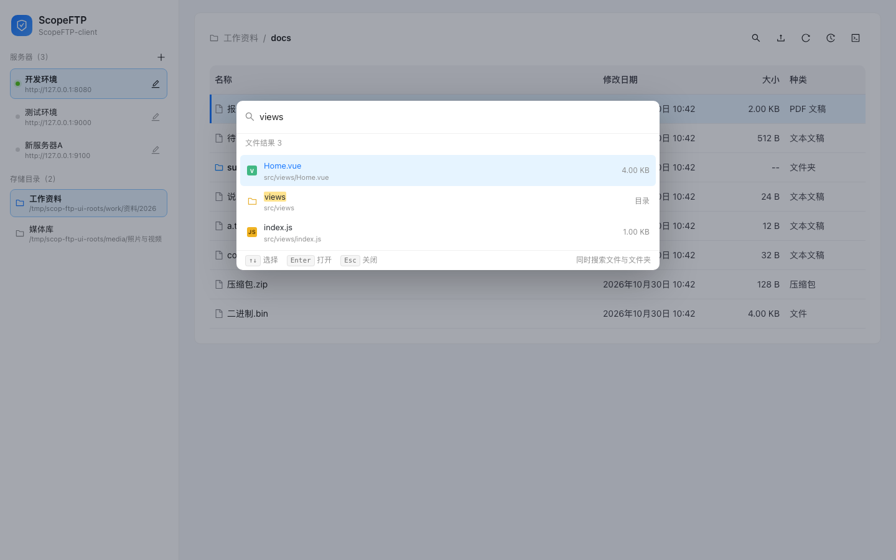

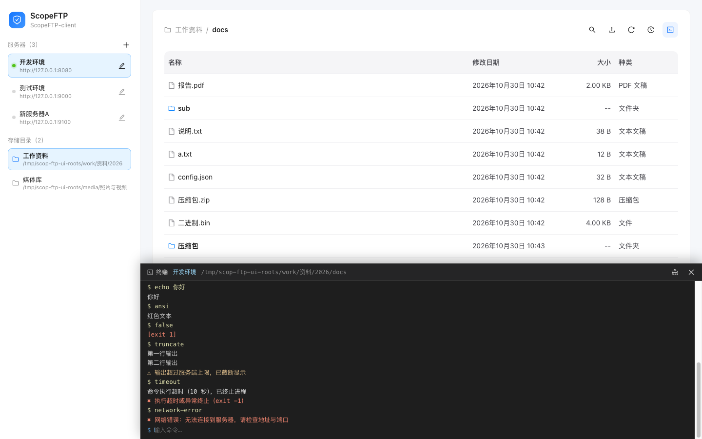

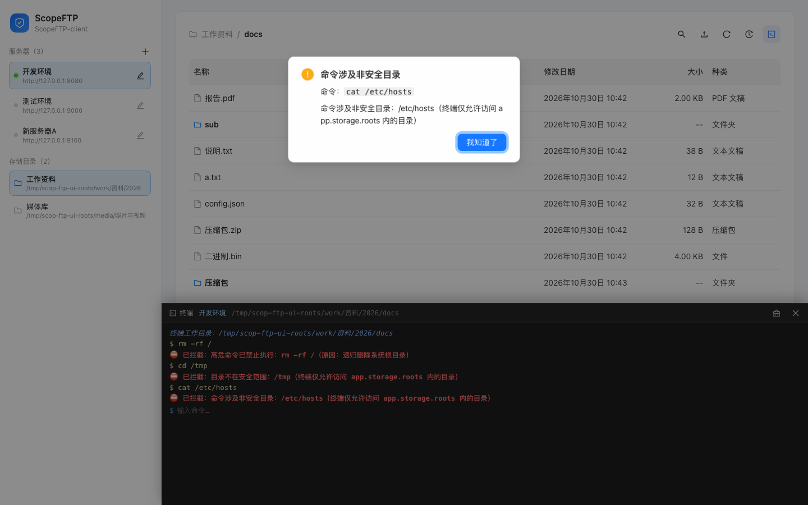

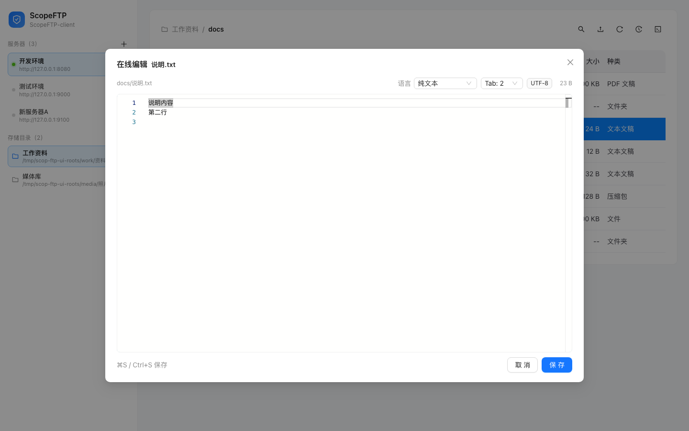

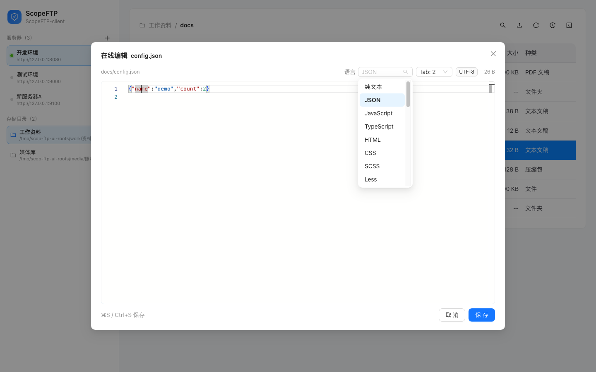

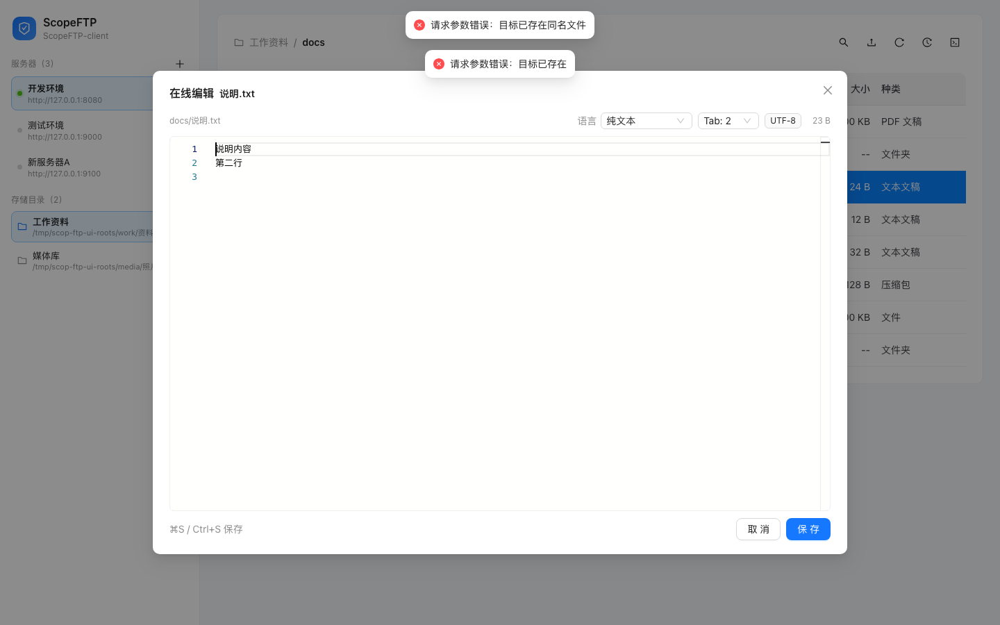

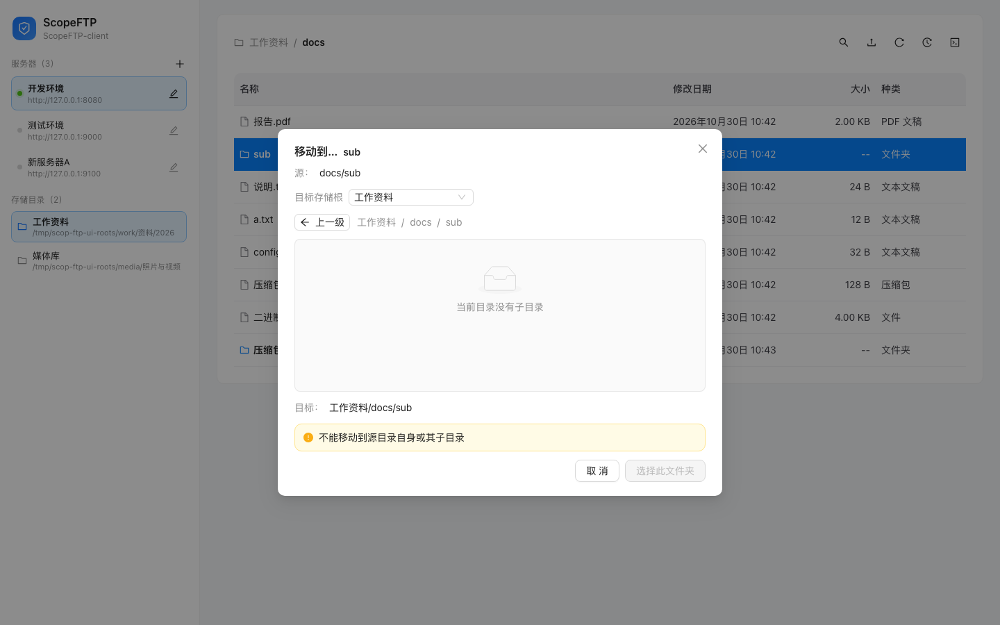

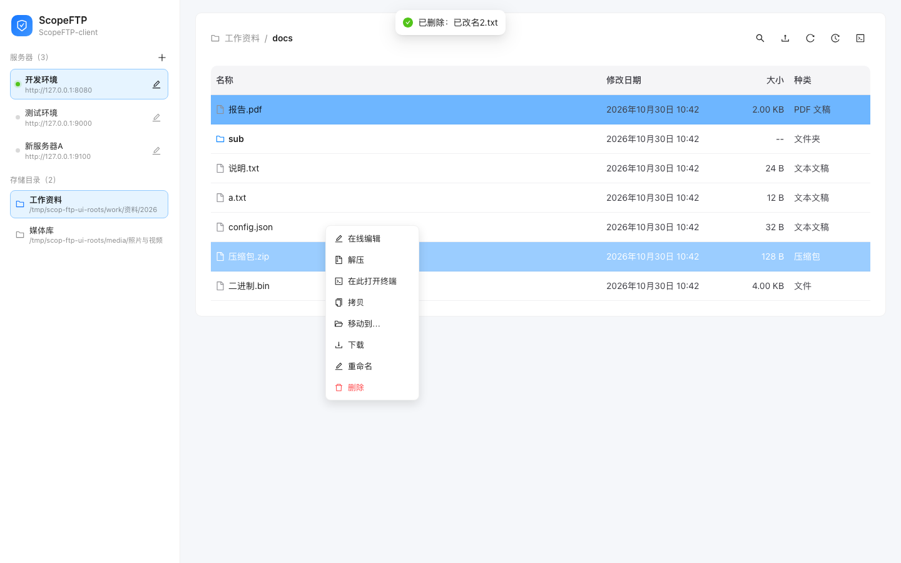

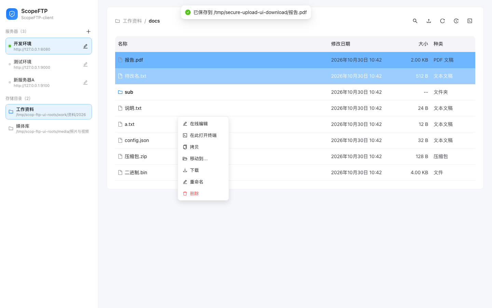

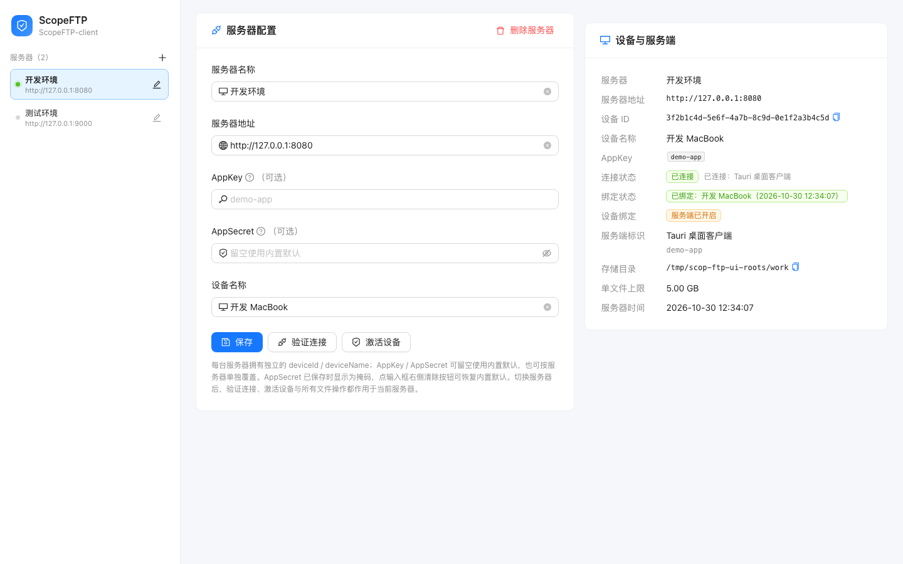

**安全（防伪验证）**

- **请求签名（HMAC-SHA256）**：每个请求都会生成新的时间戳与随机 nonce，并用当前服务器生效的 appKey/appSecret（自定义或内置）对 `method`、`path`、查询串与 body 哈希计算签名：
  `HMAC-SHA256(appSecret, v1\nappKey\ntimestamp\nnonce\nMETHOD\npath\ncanonicalQuery\npayloadHash)`
- **防重放**：服务端允许 ±5 分钟时间偏差，nonce 在 10 分钟内不可重复；只有签名校验通过后才记录 nonce
- **设备绑定**（生产建议开启）：激活后该 appKey 只允许当前 `deviceId` 调用文件接口，凭据被复制到其它机器也无法使用
- **传输安全**：生产环境必须通过 HTTPS 访问；明文 HTTP 仅建议用于本机调试
- **AppSecret 默认内置在客户端 Rust 侧**：不进入 WebView，签名全部在 Rust 侧完成；每台服务器可选自定义密钥（本地 config.json 权限 0600），未填写时使用内置默认值
- 上传文件哈希参与签名，服务端落盘后复算校验
- 令牌桶限流（appKey + IP），上传消耗更多令牌
- 服务端密钥通过环境变量注入，不进镜像/仓库；完整威胁模型见 [docs/04-security.md](docs/04-security.md)

## 目录结构

```
07_scope-ftp/
├── server/                  Spring Boot 服务端（独立 Maven 工程）
├── client/                  Tauri 2 桌面客户端
│   ├── src/                 React 18 + antd 5 页面
│   └── src-tauri/           Rust：签名、HTTP、配置、Tauri 命令
├── deploy/                  Dockerfile / docker-compose / nginx / systemd / 部署脚本
├── docs/                    架构、接口签名契约、部署、安全设计
├── scripts/                 环境、构建、端到端测试脚本
└── .cache/                  项目内构建缓存（已 gitignore）
```

## 快速开始

### 0. 启动服务端

```bash
cd 07_scope-ftp
./scripts/run-server.sh             # 本地首次无 Jar 时构建，然后监听 8080
# 健康检查：http://127.0.0.1:8080/api/health
```

如果 8080 已被其他项目占用（`lsof -nP -iTCP:8080 -sTCP:LISTEN` 可确认），脚本会直接提示；换端口启动并把客户端地址同步改掉：

```bash
SERVER_PORT=8081 ./scripts/run-server.sh
# 客户端「设置 → 服务器地址」填 http://127.0.0.1:8081
```

### 1. 启动桌面客户端

```bash
cd 07_scope-ftp/client
pnpm install --store-dir ../.cache/pnpm-store
pnpm tauri dev
```

打开「设置」页确认/修改服务器地址；AppKey、AppSecret 可留空使用内置默认值，也可为这台服务器单独填写：

| 字段 | 说明 |
| --- | --- |
| 服务器地址 | 默认 `http://127.0.0.1:8080`，首次启动自动填入并保存 |
| 设备名称 | 激活设备时提交，默认「我的设备」 |
| AppKey / AppSecret | 留空使用内置默认：`demo-app` / `demo-secret-please-change-32-bytes-min`；也可按服务器单独填写，必须与服务端启动密钥一致。已保存的自定义 AppSecret 显示为掩码，点输入框右侧清除按钮可恢复默认 |

保存 → 验证连接 → 激活设备；之后点左侧服务器回到目录，用顶栏上传按钮选择文件上传。

服务端启动时也可以手动指定密钥（不指定则使用内置默认值）：

```bash
# 直接启动 Jar（从 GitHub Actions 下载，或本地已有 Jar）
java -jar ScopeFTP-server-*.jar --app-key my-key --app-secret my-secret

# 本地脚本（会把参数转成 UPLOAD_* 环境变量）
./scripts/run-server.sh --app-key my-key --app-secret my-secret

# 或环境变量
UPLOAD_APP_KEY=my-key UPLOAD_APP_SECRET=my-secret ./scripts/run-server.sh
```

### 2. 不启动客户端也能验证接口

```bash
E2E_STORAGE_ROOT=./data node scripts/e2e.mjs          # 端到端签名测试（54 项；本地需传存储根路径以测子目录/搜索）
E2E_ROOTS="work=./work,media=./media" E2E_STORAGE_ROOT=./work node scripts/e2e.mjs  # 多根+编辑/解压用例（54 项）
./scripts/live-client-test.sh                          # 客户端 Rust 代码直连真实服务端联调
```

### 3. 构建与发布（GitHub Actions）

客户端安装包不再本地打，发布交给仓库根目录的 [`.github/workflows/scope-ftp.yml`](../.github/workflows/scope-ftp.yml)：

- 推送到 `main` 且改动 `07_scope-ftp/**`，或手动 `workflow_dispatch`，自动运行
- 服务端：跑 263 个测试、打 `ScopeFTP-server` Jar；私有 profile 配置由 GitHub Secrets 注入后再生成分环境包
- 客户端：macOS ARM64 / Intel DMG、Windows x64 免安装 exe + NSIS 安装包（`.exe`），全部作为 Actions Artifacts 下载

私有配置 `server/src/main/resources/application-{default,xiaoshan,xihu}.yml` 已加入 `.gitignore`，不会入库。首次配置见 [docs/05-ci.md](docs/05-ci.md) 的 GitHub Secrets 说明。客户端安装包仍由 Actions 生成；服务端指定环境部署包也可以按下面第 4 步在本机打。

### 4. 指定环境打包

只打某一个服务端环境（例如西湖 `xihu`）：

```bash
cd 07_scope-ftp
./deploy/build-server-profiles.sh xihu
```

脚本会先执行 `mvn -DskipTests clean package`，把当前的 `server/src/main/resources/application-xihu.yml` 打进 Jar，再生成启动脚本和配置模板。

产物：

```text
release/server/ScopeFTP-server-xihu/
  ScopeFTP-server-xihu.jar
  start.sh
  scop-ftp.env.example
  README.txt

release/server/ScopeFTP-server-xihu.zip
```

说明：

- `application-xihu.yml` 是私有配置，不要提交；修改后重新执行上面的命令即可，脚本不会改它。
- 存储根以 `application-<profile>.yml` 里的 `app.storage.roots[].path` 为准；当前 `xihu` / `xiaoshan` 是 `/risen/soft`，包内 `scop-ftp.env` 不再写 `UPLOAD_STORAGE_ROOT` 覆盖它。若想让包使用包内目录，在 `scop-ftp.env` 增加 `UPLOAD_STORAGE_ROOTS=root=./data/xihu`。
- 脚本会删除并重建 `release/server/ScopeFTP-server-xihu/`。如果包内已有 `scop-ftp.env` 等运行配置，先备份，打包后放回。
- 验证配置已经打进 Jar：

  ```bash
  unzip -l release/server/ScopeFTP-server-xihu/ScopeFTP-server-xihu.jar | grep application-xihu.yml
  ```

  应看到 `BOOT-INF/classes/application-xihu.yml`。

如果只想替换已有包里的 Jar，并保留包内的 `scop-ftp.env`：

```bash
./scripts/mvn.sh -f server/pom.xml -DskipTests clean package

OUT=release/server/ScopeFTP-server-xihu
cp server/target/ScopeFTP-server-1.0.0.jar "$OUT/ScopeFTP-server-xihu.jar"

cd release/server
rm -f ScopeFTP-server-xihu.zip
zip -q -r ScopeFTP-server-xihu.zip ScopeFTP-server-xihu
```

GitHub Actions 的 `ScopeFTP-server-profiles` Artifact 固定构建 `default`、`xiaoshan`、`xihu` 三个环境，需要三个 `APPLICATION_*_YML_BASE64` Secrets 齐全；如果只需要其中一个环境，优先使用本地 `build-server-profiles.sh <profile>`。

## 防伪验证怎么做的

```
客户端 Rust                         服务端 SignatureFilter
  │ 生成 timestamp + nonce + 签名          │
  │ ── X-App-Key / X-Timestamp / X-Nonce / X-Signature ──▶
  │                                         1. appKey 是否合法
  │                                         2. 时间戳是否在 ±5 分钟内
  │                                         3. HMAC 常量时间比较签名
  │                                         4. nonce 是否用过（防重放）
  │                                         5. 设备是否绑定一致
  │                                         6. 令牌桶是否还有额度
  │                                         7. 业务处理（上传/下载/…）
```

细节与测试向量见 [docs/02-api-contract.md](docs/02-api-contract.md)，安全边界与生产清单见 [docs/04-security.md](docs/04-security.md)。

## 验证结果（本机实际执行）

| 验证项 | 命令 | 结果 |
| --- | --- | --- |
| 服务端单元/集成测试 | `bash scripts/mvn.sh -f server/pom.xml clean test` | **263 passed / 0 failed**（含 SQLite 元数据迁移/重启、多存储根隔离、在线编辑、zip 解压安全/剥层、拷贝/移动、审计入库与查询、审计库文件被删后自动重建 schema、全部 /api 路由未签名拒绝、query/body 签名绑定、终端高危+非安全目录拦截） |
| 数据库依赖检查 | `mvn dependency:tree` 过滤 h2/jpa/hibernate | 无 H2/JPA/Hibernate；持久化仅 `sqlite-jdbc`（本地文件，无数据库服务） |
| 重启后元数据重载 | 上传后重启服务再列表/verify | 文件与设备绑定均从 SQLite 正确重载 |
| 多存储根配置 | `UPLOAD_STORAGE_ROOTS="work=<目录A>,media=<目录B>"` 启动 + e2e | 两个根隔离，用户文件落在各自根，内部元数据在各根 `.upload-meta/`，verify/roots 返回全部根 |
| 目录约束（越界拦截） | 篡改 metadata 后重启再下载/删除 | `../../etc/passwd`、`/etc/passwd`、root 外 symlink 全部返回 **40000**，外部文件未被读取/删除 |
| 端到端签名测试（默认配置） | `E2E_STORAGE_ROOT=<root> node scripts/e2e.mjs` | **54 passed / 0 failed**（含按目录上传/重名/路径下载删除/越界/未签名/分片/搜索/重命名/在线编辑/zip 解压与剥层/拷贝与移动/远程终端与目录范围限制；未设置的路径/多根用例自动跳过） |
| 端到端多存储根 + 编辑/解压 | `E2E_ROOTS="work=<rootA>,media=<rootB>" E2E_STORAGE_ROOT=<rootA> node scripts/e2e.mjs` | **54 passed / 0 failed**（含双根隔离、跨根拒绝、重命名、在线编辑、zip 解压/剥层、拷贝/跨根移动、终端 echo/cd/高危与非安全目录拒绝） |
| 端到端签名测试（开启设备绑定） | `UPLOAD_DEVICE_BINDING_ENABLED=true` + 同上 | **54 passed / 0 failed**（40300 生效） |
| 服务端/客户端自定义密钥 | `java -jar ScopeFTP-server-*.jar --app-key custom-app --app-secret ...` + `APP_KEY=custom-app APP_SECRET=... node scripts/e2e.mjs` | **54 passed / 0 failed**；直接启动 Jar、`run-server.sh`、环境变量三种方式均生效；客户端「设置」可按服务器覆盖，留空回退内置默认值 |
| 前端构建 | `pnpm build` | 成功（vite 6.4.5） |
| 客户端 Rust 单元测试 | `cargo test` | **53 passed / 3 ignored**（含契约签名向量、内置/自定义凭据、多服务器、多存储根、分片/续传、搜索/重命名/在线编辑/解压、拷贝/移动、审计查询/参数编码、终端会话参数校验） |
| 客户端 ↔ 真实服务端联调 | `./scripts/live-client-test.sh` | 健康检查/签名/激活/单次上传/列表/目录浏览/按 id 与按路径下载/删除/**22MB 分片上传**/**34MB 断点续传**/嵌套搜索/**双根隔离与跨根拒绝**全通过 |
| 客户端 UI（CDP + Tauri IPC 桩） | `.cache/ui-verify/cdp-check.mjs` | **233 项断言通过**：多服务器、多存储根切换、VSCode 式快速查找、Finder 式列表、右键菜单（拷贝/移动到…/在此打开终端）、Monaco 编辑器（Tab 2/4）、远程终端（内联输入、Tab 补全、拦截）、日志 Drawer（操作/连接合并视图、类型/操作/时间筛选、设备/IP→操作内容→时间→操作、终端命令/文件操作直显、失败操作内容红色、表格底部分页（总数/条数/跳页）/详情/全局失败提示）、1440/1280 无溢出、无未捕获异常 |
| 旧单根兼容（客户端） | 同上 | **216 项断言通过**：无 roots 时回退「根目录」、请求不带 root、旧接口全过、日志单根兼容 |
| FTP 式目录浏览与上传 | `GET /api/files/dir` + `POST /api/files/upload?dir=docs` | 根目录隐藏 `.upload-meta`，子目录可进；上传落当前目录、重名自动加序号；`../`/绝对路径/内部目录被拒 |
| Tauri 集成构建 | `pnpm tauri build --debug --no-bundle` | 成功产出可执行文件 |

## 部署到服务器

三种方式（推荐 Docker Compose）：

```bash
cd deploy
cp .env.example .env      # 修改 UPLOAD_APP_SECRET
docker compose up -d --build
```

或 Jar + systemd + Nginx，详见 [docs/03-deployment.md](docs/03-deployment.md)。

## 文档

| 文档 | 内容 |
| --- | --- |
| [docs/01-architecture.md](docs/01-architecture.md) | 架构、技术选型、本地运行 |
| [docs/02-api-contract.md](docs/02-api-contract.md) | **接口与签名契约（服务端/客户端唯一标准）** |
| [docs/03-deployment.md](docs/03-deployment.md) | Docker / systemd / Nginx / 私有 profile / 客户端联调 |
| [docs/04-security.md](docs/04-security.md) | 威胁模型、防护实现、边界限制、上线检查清单 |
| [docs/05-ci.md](docs/05-ci.md) | GitHub Actions 触发方式、私有配置 Secrets、构建产物 |

## 关于构建环境

`scripts/env.sh` 会优先使用本机 IntelliJ 自带 JDK 21/Maven（当前开发机），在 GitHub Actions 则使用 `actions/setup-java` 提供的 JDK 21 和系统 Maven：

- 本地 Maven 仓库、Cargo 缓存、pnpm store 落在项目内 `.cache/`（已忽略）
- 本地 Maven 依赖走阿里云镜像；CI 使用 Maven Central
- 本地只运行开发/测试；安装包与部署包由 GitHub Actions 生成（见 [docs/05-ci.md](docs/05-ci.md)）

## License

学习/演示用，可自由修改。
