# ScopeFTP（Spring Boot + Tauri + Ant Design）

ScopeFTP 是一个文件上传/管理桌面应用：服务端 `ScopeFTP-server`，客户端 `ScopeFTP`。

- **ScopeFTP-server**：Spring Boot 3.3.5 / Java 21，提供文件上传、列表、下载、删除接口，**SQLite 本地持久化**（元数据/审计，无需安装数据库服务）+ 本地文件存储，可直接 Docker 或 systemd 部署到服务器
- **ScopeFTP**：Tauri 2 桌面应用（Rust + React 18 + TypeScript + Ant Design 5），FTP 式浏览服务器目录，**把文件拖进右侧即上传到当前目录**，可下载/删除
- **防伪验证**：每个请求都需要 `HMAC-SHA256` 签名 + 时间戳 + 一次性 nonce，配合设备绑定与限流，**没有 appSecret 的第三方无法调用接口，抓包也无法重放**

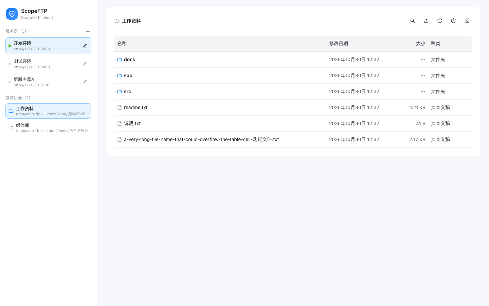

> 截图为浏览器预览模式（桌面客户端内不会出现「请使用桌面客户端运行」提示）。

## 功能特性

**服务端**

- 文件上传（**不限文件类型**、原始文件名清洗、**按当前浏览目录原名落盘**、重名自动加序号；>200MB 走**分片上传 + 断点续传**，分片 8MB、文件上限默认 5GB）
- 在存储根目录内**递归搜索**文件名，客户端可点结果直接跳到所在目录并高亮
- 文件分页列表（按文件名搜索）、按 id 或按路径下载（流式、响应头带 SHA-256）、按 id 或按路径删除（支持删除文件/目录，非空目录带 `recursive=true` 一次性递归删除并同步清理元数据）
- 统一 JSON 信封 + 错误码（40000/40001/40003/40100/40101/40102/40103/40300/40310/40311/40312/40313/40400/42900 …）
- **SQLite 本地持久化**：每个存储根的文件/设备元数据在 `<root>/.upload-meta/metadata.sqlite3`（WAL + 事务 + 内存只读索引），文件内容直接存在存储根目录；无需安装数据库，数据目录可直接挂载/备份。旧版 `files.json`/`devices.json` 启动时自动迁移并备份
- **FTP 式目录浏览**：客户端直接查看服务端存储根目录（`app.storage.roots[]`，默认 `./data`）的真实目录树；**在哪一级目录就把文件上传到哪一级**（原名落盘），并可新建空文件/文件夹、下载/删除当前目录里的文件与目录（非空目录强提示项数、二次确认后递归删除，不可恢复）；文件可直接拖进窗口上传；列表为 **Finder 风格**（名称/修改日期/大小/种类），支持 ↑↓ 选择、Enter 或再次单击重命名、双击文件用本机默认应用打开、双击文件夹进入
- **多服务器 + 多级转发**：客户端可保存多台服务器（添加/切换/编辑），每台独立设备号；配置 v3 用 `kind=direct|relay` + `parentId` 组成任意深度转发树（`A → B → C → …`），B/C 只通过 A 访问。左侧树按层级缩进显示，可直接点击切换；当前服务器详情页在「编辑」右侧提供「代理服务器」按钮（当前服务器连接成功后才可用），点击进入代理服务器填写；删除父节点会级联删除整棵子树和续传状态，允许删到空配置。转发链每跳独立 HMAC 签名、链里没有 AppSecret；B/C 审计通过 `relayVia` 记录来源 A / A→B，来源可点击切换
- **操作审计日志（可客户端查看）**：所有客户端触发的 `/api/**` 请求（含成功/失败/签名失败/限流）写入服务端 JSONL + SQLite（`app.audit.dir`，默认 `./logs/audit`），记录 requestId、appKey、设备、IP、动作、路径、参数、耗时、状态、转发来源链等；客户端顶栏日志抽屉把连接验证/设备激活与上传/下载/删除/移动/编辑/解压/终端等实际操作合并展示，用「类型 / 操作 / 时间」筛选区分（经转发的操作也会以 `relay.*` 记录并显示为「经转发 · 操作」），不把目录列表、搜索等只读 API 请求混入日志视图；支持分页和完整详情；请求体脱敏截断，不记录密钥/签名/文件正文；响应头 `X-Request-Id` 可关联
- **拷贝 / 移动**：右键文件或目录「拷贝」原地生成副本（`xxx.txt` → `xxx_副本.txt`，目录 `abc` → `abc_副本`，重名 `_副本 (1)`）；「移动到…」弹出目录选择器，可切换存储根、浏览目录后确认移动，支持文件/目录与跨根，禁止覆盖和移动到自身子目录
- **在线编辑与 zip 解压**：右键文件可「在线编辑」（内置 **Monaco（VS Code 内核）**，按扩展名自动识别并手动切换语言高亮、Tab 缩进 **2/4 空格可选并记住**、⌘S/Ctrl+S 保存，原子覆盖原文件并可检测并发修改）；右键 `.zip` 可「解压」到同级同名目录，带 zip-slip/symlink/zip bomb 防护、重名自动加序号；若 zip 内只有唯一一层顶层目录包裹全部内容，会**自动剥掉这层**（如 `pkg/a.txt` → `压缩包/a.txt`），否则保持原目录结构
- **远程终端**：底部 VS Code 风格终端面板，命令**直接在输出区输入**（内联 `$` prompt、↑↓ 历史、Ctrl/⌘+L 清屏、点击输出区聚焦），支持 **Tab 路径补全**（目录补 `/`、文件补空格、多候选列出）；`cd` 会话内生效、输出截断/超时提示；右键文件/目录可选「在此打开终端」——文件定位到所在目录、目录定位到该目录，工具栏终端定位到当前目录；**只能访问配置的 `app.storage.roots` 内目录**——`cd /tmp`、`cat /etc/...`、根外重定向等越界命令会被拒绝；内置高危命令护栏（`rm -rf /`、`sudo`、`mkfs`、关机、fork bomb、`curl | sh` 等）——命中即拒绝执行并弹警告说明原因；可用 `app.terminal.enabled: false` 关闭（写在对应用的环境文件里）
- **右键菜单**：目录空白处右击可「新建文件」「新建文件夹」「在此打开终端」（终端定位到当前目录）；客户端已全局关闭 WebView 默认右键菜单（Reload / Inspect Element 等），仅在输入框、文本域、编辑器内保留系统复制/粘贴菜单；目录/文件行右击可「新建文件」「新建文件夹」「重命名」「删除」；右键文件夹时新建到该文件夹内，右键文件时新建到其所在目录；新建时弹窗输入单段名称，服务端严格校验父目录/名称/冲突且不覆盖，新文件为空文件；重命名直接在行内名称单元格编辑（回车/失焦保存、Esc 取消），支持文件与目录（严格同根校验、不覆盖同名）；删除支持文件与目录，目录非空时先列目录统计项数并强提示「目录非空（共 N 项），其中的文件和子目录会一并删除，且不可恢复」，二次确认后递归删除（含嵌套存储根拒绝、symlink 不跟随）
- **多存储根目录**：服务端可配置多个存储根（各环境文件的 `app.storage.roots[]`，`id`/`name`/`path`），客户端左侧「存储目录」切换；所有浏览/上传/下载/删除/搜索都严格限制在选中的根内，跨根/根外操作一律拒绝；单根 `root-dir` 已删除，roots 为空启动失败
- **存储目录可配置且严格受限**：各环境文件用 `app.storage.roots[]` 指定服务器存储根目录（dev 是 `./data`、docker 是 `/app/data`），服务端只能在配置的根内读写删（拒绝 `../`、绝对路径、符号链接逃逸、跨根），客户端无法指定服务器路径
- 全链路测试 341 个（JUnit 5 + MockMvc + 固定 Clock 签名向量 + SQLite MetaStore 并发/重启/迁移 + 存储目录约束 + FTP 式按目录上传/路径下载删除 + 分片上传/续传/搜索/限流 + 多存储根隔离 + 重命名/递归删除目录（含嵌套存储根拒绝）+ 新建文件/文件夹 + 客户端身份/黑名单/verify→activate 顺序 + 解压剥层/拷贝移动 + 审计 SQLite/查询接口测试 + relay 链头/每跳签名/3 跳/8MB 流式/SSRF/错误映射/审计迁移）

**客户端**

- **托盘常驻**：点窗口左上角 X 只隐藏窗口，应用继续驻留 macOS 菜单栏；点击菜单栏托盘图标（左键或右键）直接打开窗口，不弹下拉菜单；点击程序坞图标也会重新打开窗口；真正退出走程序坞图标右键「退出」或 ⌘Q
- **左右两栏主界面**：左边是**多台服务器列表**（添加/切换、行右侧信息图标查看「设备与服务端」详情，编辑从详情页进入；按父节点递归成转发树；选择任一台时自动检测同一根节点下所有服务器的连通性，绿点=通、灰点=不通、黄点=检测中）+「存储目录」切换；右边是服务器目录浏览器（面包屑、刷新、上传按钮；**支持把文件/多文件直接拖进右侧上传到当前目录**，文件行可下载/删除，目录行可删除（非空目录二次确认后递归删除））。编辑页只有配置表单 +「保存配置」+「验证连接」（保存只落本地配置；验证成功后自动保存并激活，然后回到详情页）；「设备与服务端」详情页展示连接状态、设备绑定、服务端标识、存储目录与大小上限，以及本机 MAC / 本机 IP（排除 127.0.0.1/localhost），非当前服务器只展示静态配置；详情页右侧可直接删除服务器，删除父服务器会级联删除其下所有代理服务器的本地配置（不会删除服务端文件）
- **VSCode 式快速查找（⌘P / Ctrl+P）**：命令面板式浮层，同时搜索文件夹与文件，显示名称+相对路径与类型图标，↑↓ 选择、Enter 打开（文件跳到所在目录并高亮、目录直接进入）、Esc 关闭；只搜当前存储根
- 设置从左侧进入，点左侧服务器（含当前服务器）即可回到目录：服务器地址、AppKey/AppSecret（必填）、设备名称、保存配置（只保存本地配置）、验证连接（成功后自动保存并激活设备）、只读显示服务端存储目录
- **AppKey / AppSecret**：保存服务器时填写，必须与服务端启动时一致；**relay 必须显式填写目标自己的 AppKey/AppSecret，不回退内置值**；direct 的旧配置空值仍可回退编译期内置值（发布构建用 `UPLOAD_CLIENT_APP_KEY/SECRET` 覆盖）
- **代理服务器添加**：当前服务器详情页的「代理服务器」按钮只在当前服务器连接成功后可用；B 的表单必须填目标地址 + B 的 AppKey/AppSecret + 设备名，点「保存配置」可直接落本地配置；点「验证连接」（整链预检）成功后才保存/切换。编辑已保存 B/C 不要求父链连接；删除已保存服务器允许删到空配置，新建表单不显示删除
- **长路径显示**：面包屑、移动弹窗里的目录路径过长时自动换行（不裁剪、不省略），当前目录始终可见
- **所有网络请求与签名都在 Rust 侧完成**，常规配置视图不返回 appSecret；仅设置页点击密码框眼睛时按服务器 id 读取本地自定义值
- 上传前先算 SHA-256、流式上传并回传进度；下载边写盘边校验 SHA-256
- **操作 / 连接日志（合并视图）**：顶栏时钟图标打开右侧抽屉，连接验证/设备激活与上传/下载/删除/移动/编辑/解压/终端等实际操作按时间混排；目录浏览、搜索等只读请求仍保留在底层审计库，但不进入日志视图。支持类型/操作/时间范围筛选、服务端分页；列表按「设备/IP → 操作内容 → 时间 → 操作」展示，终端命令与文件路径/重命名/拷贝/移动目标直接显示，不再显示接口路径、结果和耗时；详情保留 requestId、body/终端命令/IP/设备等诊断字段；只查当前登录 appKey 的记录
- Ant Design 5 中文语言包 + 自定义主题 token

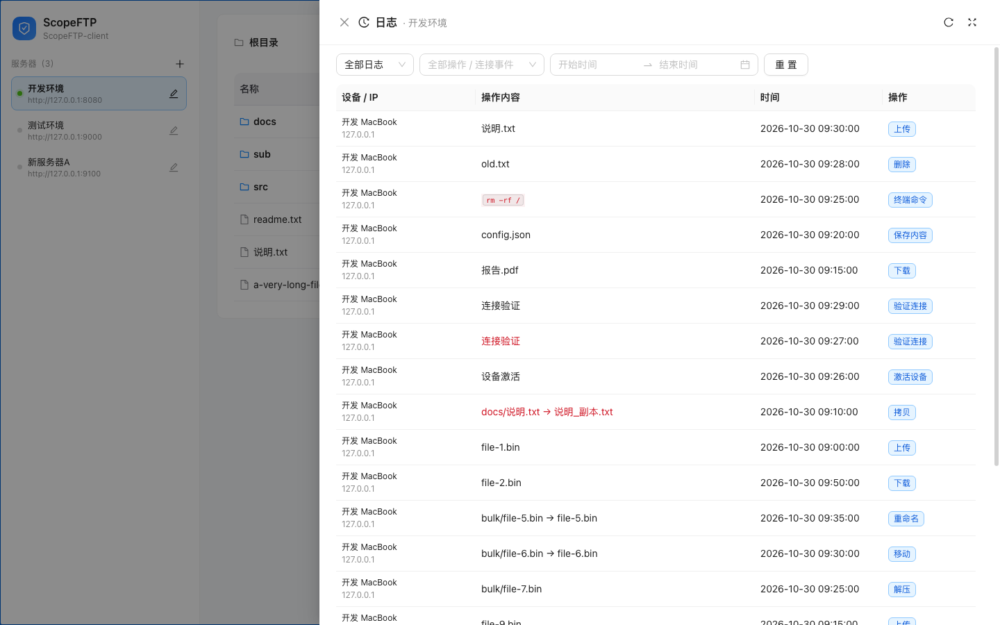

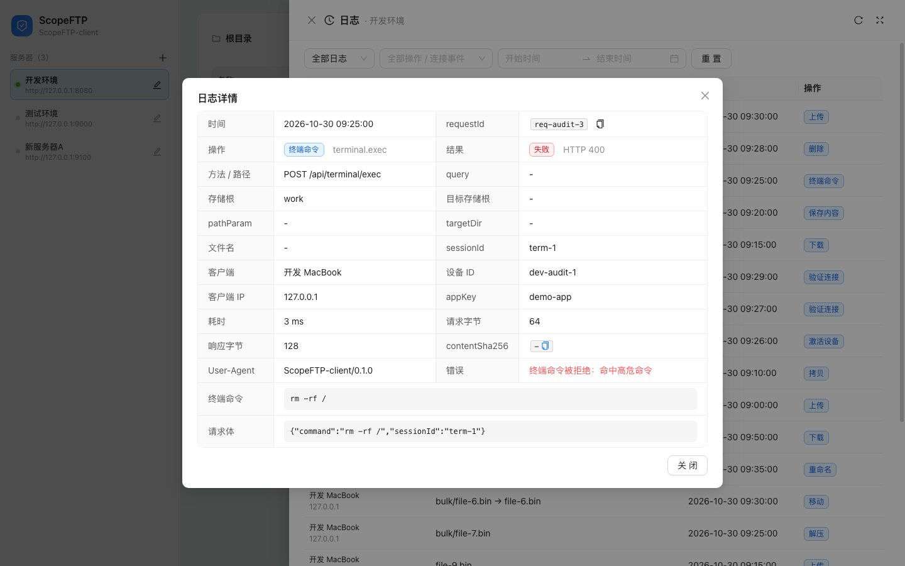

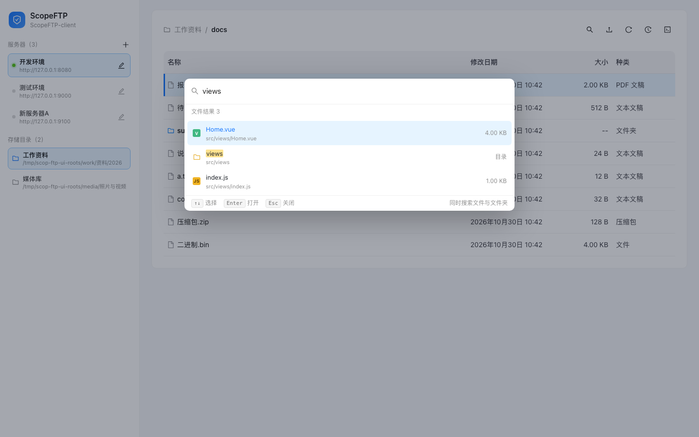

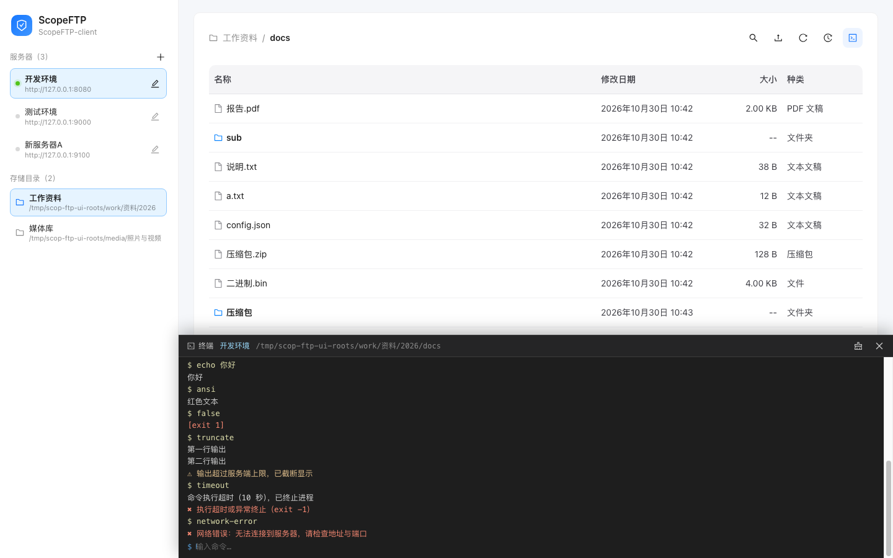

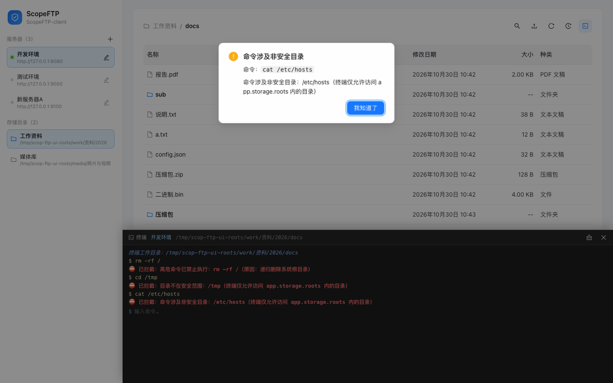

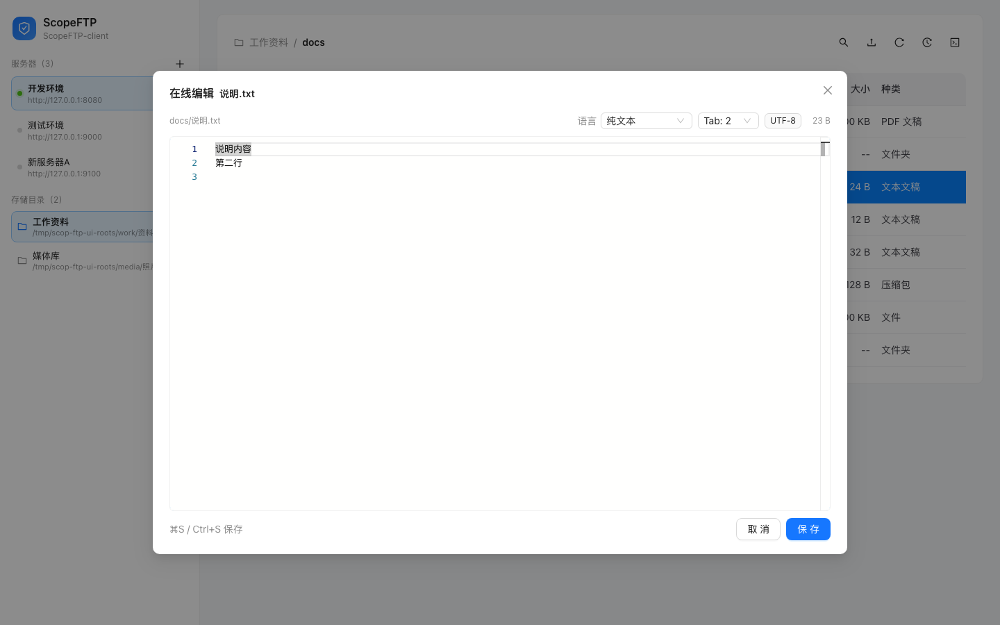

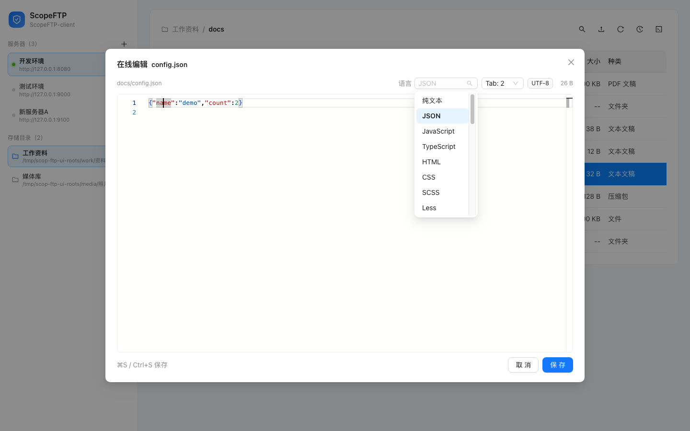

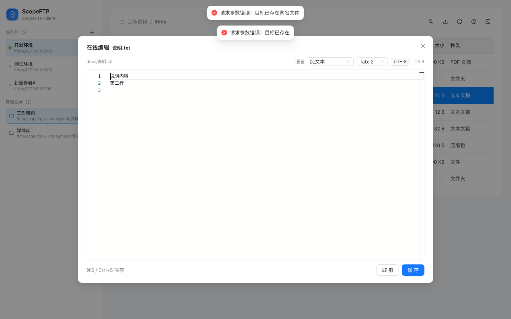

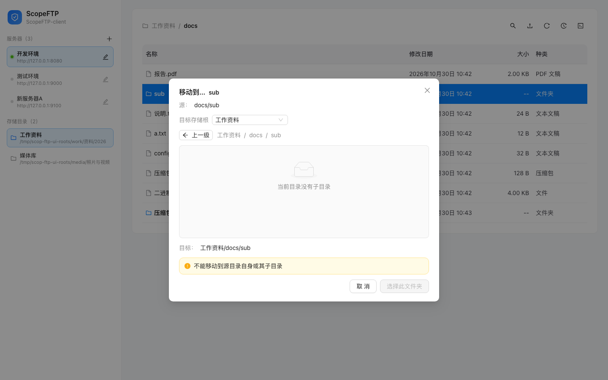

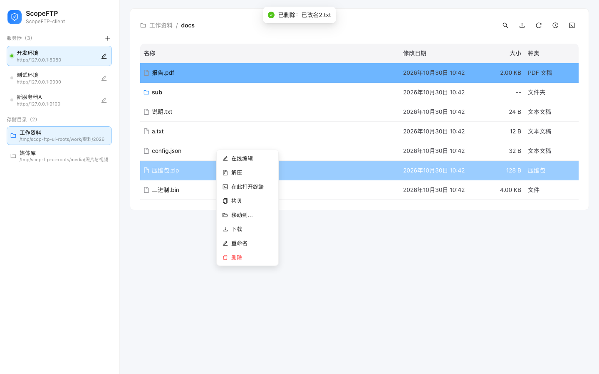

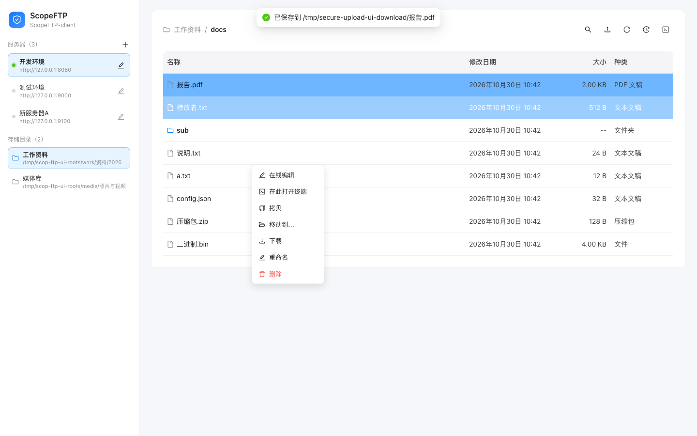

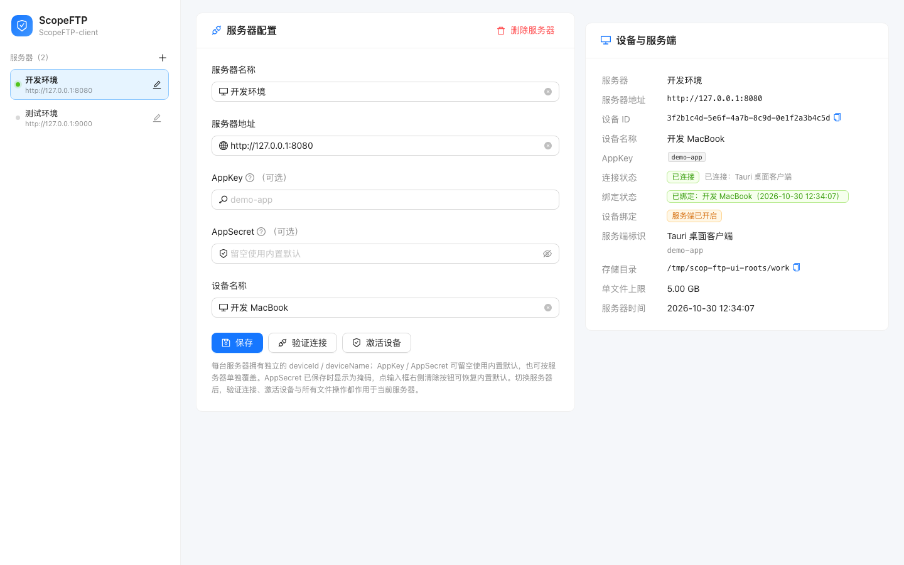

## 客户端自动更新

客户端每天本机时间 **10:00、16:00** 自动检查更新；启动时如果距上次检查超过 6 小时会补检一次。
发现新版本后会在后台自动下载、安装，完成后弹窗让用户确认是否立即重启（上传进行中不会强制重启）。

- 更新包使用 Tauri 签名校验，更新清单是 GitHub Release 的 `latest.json`；macOS 使用 `.app.tar.gz`，Windows 使用 NSIS 安装包 `.exe`。
- 首次从 v1.0.2 升级需要手动安装一次 v1.0.3；从 v1.0.3 起可以自动更新到后续版本。
- 发布时客户端版本必须与 tag 一致（例如 tag `v1.0.3` 对应 `1.0.3`）。
- CI 需要仓库 Secret `TAURI_SIGNING_PRIVATE_KEY`（私钥），否则构建会直接失败，不会产出未签名更新包。

**安全（防伪验证）**

- **请求签名（HMAC-SHA256）**：每个请求都会生成新的时间戳与随机 nonce，并用当前服务器在设置页里配置的 appKey/appSecret 对 `method`、`path`、查询串与 body 哈希计算签名：
  `HMAC-SHA256(appSecret, v1\nappKey\ntimestamp\nnonce\nMETHOD\npath\ncanonicalQuery\npayloadHash)`
- **防重放**：服务端允许 ±5 分钟时间偏差，nonce 在 10 分钟内不可重复；只有签名校验通过后才记录 nonce
- **设备绑定**（生产建议开启）：激活后该 appKey 只允许当前 `deviceId` 调用文件接口，凭据被复制到其它机器也无法使用
- **客户端身份强制校验**（本地 dev 与萧山/西湖环境文件已开启；全新克隆无环境文件时默认关闭，测试 profile 关闭）：所有 `/api/**`（含 `/api/health`）必须带客户端读取的 `X-Device-Mac`；服务端维护 `client_blacklist_ip` / `client_blacklist_mac` 两张黑名单（**任一命中即拦截**）。缺 MAC/IP → 40312、命中 IP → 40310、命中 MAC → 40311、activate 前无近期 verify（乱序）→ 40313，并同时写入两张黑名单。解封只能手动删数据库行（删一张表仍会被另一张拦截）：
  ```sql
  sqlite3 <root>/.upload-meta/metadata.sqlite3 \
    "DELETE FROM client_blacklist_ip WHERE ip='1.2.3.4'; \
     DELETE FROM client_blacklist_mac WHERE mac='AA:BB:CC:DD:EE:FF';"
  ```
  地址/指纹格式、verify→activate 时间窗（默认 10 分钟）见 [docs/04-security.md](docs/04-security.md)。
- **传输安全**：生产环境必须通过 HTTPS 访问；明文 HTTP 仅建议用于本机调试
- **AppSecret 只保存在客户端 Rust 侧**：不进入 WebView，签名全部在 Rust 侧完成；secret 落盘权限 0600，relay 的 secret 只在客户端本地，不进入链头
- 上传文件哈希参与签名，服务端落盘后复算校验
- **多级转发**：relay 配置默认关闭；本地 `scripts/run-server.sh` 和分包 `start.sh` 默认注入 `--app.relay.enabled=true`，开发时不需要手动开启（直接 `java -jar`/其它部署仍默认关闭）；转发链每跳独立签名，A 改 path/query/body 会让下游验签失败；目标 URL 经 SSRF 守卫（默认拒绝 loopback/link-local/云元数据，私网可配置放行）；链头/来源头有长度与跳数上限，错误映射 40010/40320/40110/50210/50211/50212/50410
- 令牌桶限流（appKey + IP），上传消耗更多令牌
- 服务端凭证必须显式传入（`--app-key`/`--app-secret`；Docker Compose 仍可用 `.env` 环境变量），没有内置默认值、缺失时启动失败，不进镜像/仓库；完整威胁模型见 [docs/04-security.md](docs/04-security.md)

## 目录结构

```
07_scope-ftp/
├── server/                  Spring Boot 服务端（独立 Maven 工程）
├── client/                  Tauri 2 桌面客户端
│   ├── src/                 React 18 + antd 5 页面
│   └── src-tauri/           Rust：签名、HTTP、配置、Tauri 命令
├── deploy/                  Dockerfile / docker-compose / nginx / systemd / 部署脚本
├── docs/                    架构、接口签名契约、部署、安全设计
├── scripts/                 环境、构建、端到端测试脚本
└── .cache/                  项目内构建缓存（已 gitignore）
```

## 快速开始

### 0. 启动服务端

```bash
cd 07_scope-ftp
# 凭证没有内置默认值；AppSecret 任意非空即可，生产推荐用 openssl 生成
APP_SECRET="$(openssl rand -hex 32)"
./scripts/run-server.sh --app-key my-key --app-secret "$APP_SECRET"   # 首次无 Jar 会自动构建，监听 9090
# 健康检查（开启客户端身份强制后需带 X-Device-Mac）：
curl -H 'X-Device-Mac: 02:00:00:00:00:01' http://127.0.0.1:9090/api/health
```

> 本机 JDK 路径不用每次 export：把 `JAVA_HOME` 写进 `scripts/env` / `scripts/env.local` 即可；不写则脚本自动探测（macOS `java_home -v 21`、Linux 常见路径），最后回退本机 IntelliJ JDK。Maven 不需要配置：脚本优先用 PATH 里的 mvn，找不到时用本机 IntelliJ 自带 Maven。
> 配置文件按环境覆盖，优先级从低到高为 `scripts/env → scripts/env.local → scripts/env.<profile> → scripts/env.local.<profile>`；例如 `--env dev` 时 `env.local.dev > env.dev > env.local > env`，打包 `xihu` 时 `env.local.xihu > env.xihu > env.local > env`。文件名含 `local` 的配置不入库，其余 `env[.<profile>]` 可按需入库。

服务端配置分两层：入库的 `server/src/main/resources/application.yml` 自带端口/存储/日志默认值
（9090、`./data`、`./logs/audit`），**但客户端凭证没有默认值**；没有 dev/prod 环境文件也能打包，
启动时必须显式传 `--app-key` / `--app-secret`，缺失会直接启动失败。
`run-server.sh` 和直接 `java -jar` 都会在启动前一次性提示这两项；AppSecret 不是只能填 32 字节，
任意非空字符串即可（少于 32 字符服务端只警告不阻止），推荐 `openssl rand -hex 32`。
需要覆盖其它配置时在本地放 `application-<env>.yml`（**均不入库**，见 `.gitignore`），启动时用 `--env` 选择。

| 环境 | 启动方式 | 端口 | 存储根 | 审计 / 运行日志 |
| --- | --- | --- | --- | --- |
| `dev`（默认） | `./scripts/run-server.sh --app-key … --app-secret …`（凭证必填） | 9090 | `./data` | `./logs/dev/` |
| `docker` | `docker compose up -d --build` | 8080 | `/app/data` | `/app/logs/` |
| `xiaoshan` | `--env xiaoshan`（私有配置） | 8080 | `/risen/soft` | `./logs/xiaoshan/` |
| `xihu` | `--env xihu`（私有配置） | 8787 | `/risen/soft` | `./logs/xihu/` |

- **新增开发环境**：复制 `application.yml` 为 `application-<env>.yml`，改端口/存储根/审计/日志 4 处，然后 `./scripts/run-server.sh --env <名字>`；
  该文件不入库；不同环境端口、数据、日志互不干扰。
- 环境文件改动（新增/修改 `application-*.yml`）会被脚本自动检测并重新打包；也可显式加 `--build` 强制重新打包。直接启动 Jar 时用 `--spring.profiles.active=<env>` 选择环境。
- 全环境通用参数（大小上限、分片、限流、终端超时等）在 `application.yml`；客户端凭证不再写入
  `scripts/env*` 或包内 `scop-ftp.env`，启动时通过 `--app-key` / `--app-secret` 传入。

如果 9090 已被其他项目占用（`lsof -nP -iTCP:9090 -sTCP:LISTEN` 可确认），脚本会直接提示；换端口即可：

```bash
./scripts/run-server.sh --server.port=8081    # 临时换端口
# 也可以改 application.yml（或本地环境文件）里的 server.port
# 客户端「设置 → 服务器地址」填 http://127.0.0.1:8081
```

### 1. 启动桌面客户端

```bash
cd 07_scope-ftp/client
pnpm install --store-dir ../.cache/pnpm-store
pnpm tauri dev
```

打开「设置」页确认/修改服务器地址；AppKey、AppSecret 为必填项，必须与服务端启动时指定的一致：

| 字段 | 说明 |
| --- | --- |
| 服务器地址 | 默认 `http://127.0.0.1:9090`，首次启动自动填入并保存 |
| 设备名称 | 验证连接成功后自动激活时提交，默认「我的设备」 |
| AppKey / AppSecret | **必填**，必须与服务端启动时指定的 AppKey / AppSecret 一致（服务端没有内置默认值，缺失会启动失败）。已保存的自定义 AppSecret 显示为掩码 |

设置页有两个操作按钮：「保存配置」只保存本地配置，不验证、不激活，适合先落盘稍后再修/验证；「验证连接」先验证，成功再保存配置、再自动激活设备（添加页无需先添加；激活失败时保留服务器并提示原因，验证失败则不保存）；非当前服务器只能保存，验证需先在左侧切换；激活前客户端会先调一次 verify，避免被服务端按乱序封禁。之后点左侧服务器回到目录，用顶栏上传按钮选择文件上传。

### 1.1 多级转发（A → B → C）操作

1. 先添加直连 A（地址/AppKey/AppSecret），点「验证连接」直到左侧 A 显示已连接。
2. 选中 A → 打开 A 的「设备与服务端」详情页 → 点「代理服务器」；填 **B 的目标地址**（A 能访问的地址）+ **B 自己的 AppKey/AppSecret** + 设备名；同一转发链每跳 AppKey 必须不同，重复会报「转发链 appKey 重复」。可先「保存配置」落盘，再点「验证连接」。A 未连接时这个按钮不可用。
3. 选中 B，同样添加 C；左侧树会按 A → B → C 缩进显示。
4. 点击左侧 B/C 切换，右侧浏览/上传/下载都经 A（或 A→B）转发。
5. B/C 的审计详情「来源/转发链」显示 A / A→B，点击来源可切到本地对应服务器。
6. 删除 A 会级联删除 B/C 的本地配置和续传状态；删到最后一台后显示空配置，重启不会被自动补回。

本地 `scripts/run-server.sh` 和分发包的 `start.sh` 默认注入 `--app.relay.enabled=true`，A/B 不需要再手动传：

```bash
./scripts/run-server.sh --app-key ak-a --app-secret sk-a-...
# 不想开放转发时，可显式关闭：
# ./scripts/run-server.sh --app-key ak-a --app-secret sk-a-... --app.relay.enabled=false
```

> 直接 `java -jar` 启动或其它部署方式仍按 `application.yml` 默认关闭；需要转发时显式加 `--app.relay.enabled=true`。

> B/C 不要直接暴露给客户端或公网，只允许 A/上一跳访问；旧客户端把 v3 relay 当 direct 可能绕过 A，发布期限制 B/C 可达性或轮换凭据。

服务端启动时必须指定密钥，没有内置默认值（缺失时启动失败）：

```bash
# 直接启动 Jar（从 GitHub Actions 下载，或本地已有 Jar）
APP_SECRET="$(openssl rand -hex 32)"
java -jar ScopeFTP-server-*.jar --spring.profiles.active=dev --app-key my-key --app-secret "$APP_SECRET"

# 本地脚本（--app-key/--app-secret 透传给服务端，映射到第一个预配发客户端）
./scripts/run-server.sh --app-key my-key --app-secret "$APP_SECRET"
```

### 2. 不启动客户端也能验证接口

```bash
# 服务端必须用相同凭证启动（客户端没有内置默认凭证，APP_KEY/APP_SECRET 必须与服务端一致）
APP_KEY=my-key APP_SECRET=my-secret E2E_STORAGE_ROOT=./data node scripts/e2e.mjs  # 端到端签名测试（55 项；本地需传存储根路径以测子目录/搜索/递归删除）
APP_KEY=my-key APP_SECRET=my-secret E2E_ROOTS="work=./work,media=./media" E2E_STORAGE_ROOT=./work node scripts/e2e.mjs  # 多根+编辑/解压用例（55 项）
./scripts/live-client-test.sh                          # 客户端 Rust 代码直连真实服务端联调（服务端需用客户端同款凭证）
```

### 3. 构建与发布（GitHub Actions）

客户端安装包不再本地打，发布交给仓库根目录的 [`.github/workflows/scope-ftp.yml`](../.github/workflows/scope-ftp.yml)：

- **只有推送 `v*` tag（如 `v1.0.0`）才触发构建**；普通 `main` push、PR、手动发布 Release 都不会触发
- tag 构建完成后自动上传 Actions Artifacts，并创建 GitHub Release 上传服务端部署包和客户端安装包
- 服务端：跑测试后始终生成可部署的 `ScopeFTP-Server.zip`（包内固定 `ScopeFTP-Server/` + `ScopeFTP-Server.jar` + `start.sh` + `scop-ftp.env`）；私有生产配置（萧山/西湖）由 GitHub Secrets 注入后，额外生成 `ScopeFTP-Server-xiaoshan.zip` / `ScopeFTP-Server-xihu.zip`；**启动时没有凭证会失败**
- 客户端：macOS ARM64 / Intel DMG、Windows x64 免安装 exe + NSIS 安装包（`.exe`），全部作为 Actions Artifacts 下载

所有 `server/src/main/resources/application-<env>.yml` 环境文件（dev/docker/xiaoshan/xihu）**一律不入库**
（已被 `.gitignore` 的 `server/src/main/resources/application-*.yml` 过滤）；仓库里只入库 `application.yml`，
它自带端口/存储/日志默认值，但**没有客户端凭证默认值**：打包不需要私有配置，启动必须显式传 `--app-key` / `--app-secret`。生产配置本地保留或由 CI Secrets 注入。
首次配置见 [docs/05-ci.md](docs/05-ci.md) 的 GitHub Secrets 说明。客户端安装包仍由 Actions 生成；服务端指定环境部署包也可以按下面第 4 步在本机打。

### 4. 打包服务端部署包

```bash
cd 07_scope-ftp
./deploy/build-server-profiles.sh               # profile=default（application.yml）
./deploy/build-server-profiles.sh xihu          # profile=xihu（application-xihu.yml）
```

命名规则：

- 产物名固定，不随 profile 变化：
  - 目录：`release/server/ScopeFTP-Server/`
  - 压缩包：`release/server/ScopeFTP-Server.zip`
  - 包内 Jar：`ScopeFTP-Server.jar`
  - 包内启动脚本：`start.sh`、`scop-ftp.env`
- 不传配置名 → `default`：不激活 Spring profile，直接使用 jar 内 `application.yml`
- 传 `xihu` → 使用 `application-xihu.yml`，启动自动带 `--spring.profiles.active=xihu`
- 一次只能指定一个 profile；换 profile 重新打包会覆盖上一次的固定名产物，需要两个包时请分别构建并另存备份

脚本会先执行 `./scripts/mvn.sh -f server/pom.xml -DskipTests clean package`，再按 `scripts/env*` 里该配置名的生效配置生成启动脚本和包内 `scop-ftp.env`（不再生成 `.example` 模板）。

产物：

```text
release/server/
  ScopeFTP-Server/
    ScopeFTP-Server.jar
    start.sh
    scop-ftp.env        # 由 scripts/env* 生成，可直接使用
  ScopeFTP-Server.zip
```

启动 / 停止（包内 `start.sh`，默认后台运行）：

```bash
cd release/server/ScopeFTP-Server
./start.sh -h           # 查看全部命令
./start.sh --app-key=xxx --app-secret=yyy   # 后台启动，日志写入 logs/console.log
./start.sh logs         # 跟随日志；Ctrl+C 只退出日志，不会停服务
./start.sh status       # 查看状态
./start.sh stop         # 停止
./start.sh restart      # 重启（同样要带 --app-key/--app-secret）
./start.sh run          # 前台启动（调试用，Ctrl+C 停止服务）
```

`--app-key` / `--app-secret` 是**必传凭证**，启动时直接传参，不写入包内 `scop-ftp.env`；其余参数可选（方括号表示可选）：

```bash
./start.sh --app-key=xxx --app-secret=yyy [--server.port=xxx] [--spring.profiles.active=xxx] [其它 Spring 参数...]

./start.sh --app-key=my-key --app-secret=my-secret          # 前台启动
./start.sh start --app-key=my-key --app-secret=my-secret    # 后台启动
```

> 凭证没有内置默认值：启动命令没传 `--app-key` / `--app-secret` 时，`start.sh` 会在启动前报「缺少客户端凭证」，不会先把进程拉起来再失败。

说明：

- `default` 包没有 `application-<profile>.yml`，端口/存储/审计/日志都取 `application.yml` 默认值（9090、`./data`、`./logs/audit`）；`xihu` 等环境包使用对应的 `application-<profile>.yml`。
- 端口、存储根、审计/日志目录都以 jar 内配置为准（xihu / xiaoshan 存储根是 `/risen/soft`）；包内 `scop-ftp.env` 只放 JDK、JVM 参数。
- 包内 `scop-ftp.env` 由 `scripts/env*` 生成，写入 `JAVA_HOME`、`JAVA_OPTS`；凭证只在启动命令里传，不落盘。
- 凭证没有内置默认值：`./start.sh` / `./start.sh start` / `./start.sh restart` 都必须带 `--app-key` / `--app-secret`，否则启动前直接报错。
- `scop-ftp.env` 已设 `600` 权限；打包机的 JDK 路径会原样写入，如果和部署机不同，请先在 `scripts/env.local.<profile>` 配部署机路径再打包。
- 服务器有多个 Java 版本时，优先在 `scripts/env.local.<profile>` 配好 `JAVA_HOME` 再打包；也可以打包后改包内 `scop-ftp.env`（`start.sh` 会用它启动并校验版本 ≥ 21），不配置则用 `PATH` 里的 `java`。
- `scripts/env*` 里把 `JAVA_HOME` 留空（`JAVA_HOME=`）时，包内 `scop-ftp.env` 不会写入空值；`start.sh` 会使用启动前 shell 的 `JAVA_HOME`，没有则用 `PATH` 里的 `java`。
- 每次构建会先清理 `release/server/` 下旧的 `ScopeFTP-Server` / `ScopeFTP-Server.zip`（以及历史 `ScopeFTP-Server-*`），再生成本次指定 profile 的固定名产物；重新打包会覆盖包内 `scop-ftp.env`，临时修改请先备份，长期配置写进 `scripts/env*`。
- 验证配置已经打进 Jar（以 xihu 为例）：

  ```bash
  unzip -l release/server/ScopeFTP-Server/ScopeFTP-Server.jar | grep application-xihu.yml
  ```

  应看到 `BOOT-INF/classes/application-xihu.yml`；`default` 包则检查 `BOOT-INF/classes/application.yml`。

如果只想替换已有包里的 Jar，并保留包内的 `scop-ftp.env`：

```bash
./scripts/mvn.sh -f server/pom.xml -DskipTests clean package

OUT=release/server/ScopeFTP-Server
cp server/target/ScopeFTP-server-1.0.0.jar "$OUT/ScopeFTP-Server.jar"

cd release/server
rm -f ScopeFTP-Server.zip
zip -q -r ScopeFTP-Server.zip ScopeFTP-Server
```

GitHub Actions 的 `ScopeFTP-Server-package` Artifact 始终包含默认 `ScopeFTP-Server.zip`；两个 `APPLICATION_*_YML_BASE64` Secrets 齐全时还会额外生成 `ScopeFTP-Server-xiaoshan.zip` / `ScopeFTP-Server-xihu.zip`。本地一次只能打一个环境。

## 防伪验证怎么做的

```
客户端 Rust                     服务端 ClientGuardFilter → SignatureFilter
  │ 读取本机 MAC；生成 timestamp + nonce + 签名 │
  │ ── X-Device-Mac / X-App-Key / X-Timestamp / X-Nonce / X-Signature ──▶
  │                                         0. 身份强制时：MAC/IP 是否缺失、是否命中黑名单（含 /api/health）
  │                                         1. appKey 是否合法
  │                                         2. 时间戳是否在 ±5 分钟内
  │                                         3. HMAC 常量时间比较签名
  │                                         4. nonce 是否用过（防重放）
  │                                         5. 设备是否绑定一致
  │                                         6. 令牌桶是否还有额度
  │                                         7. activate 前是否有近期 verify（否则 40313 并封禁）
  │                                         8. 业务处理（上传/下载/…）
```

细节与测试向量见 [docs/02-api-contract.md](docs/02-api-contract.md)，安全边界与生产清单见 [docs/04-security.md](docs/04-security.md)。

## 验证结果（本机实际执行）

| 验证项 | 命令 | 结果 |
| --- | --- | --- |
| 服务端单元/集成测试 | `bash scripts/mvn.sh -f server/pom.xml clean test` | **280 passed / 0 failed**（含 SQLite 元数据迁移/重启、多存储根隔离、在线编辑、zip 解压安全/剥层、拷贝/移动、递归删除非空目录与元数据清理、嵌套存储根防护、**客户端身份强制/黑名单/verify→activate 顺序/40310–40313**、审计入库与查询、审计库文件被删后自动重建 schema、全部 /api 路由未签名拒绝、query/body 签名绑定、终端高危+非安全目录拦截） |
| 数据库依赖检查 | `mvn dependency:tree` 过滤 h2/jpa/hibernate | 无 H2/JPA/Hibernate；持久化仅 `sqlite-jdbc`（本地文件，无数据库服务） |
| 重启后元数据重载 | 上传后重启服务再列表/verify | 文件与设备绑定均从 SQLite 正确重载 |
| 多存储根配置 | `application-dev.yml` 配两个根启动 + e2e | 两个根隔离，用户文件落在各自根，内部元数据在各根 `.upload-meta/`，verify/roots 返回全部根 |
| 目录约束（越界拦截） | 篡改 metadata 后重启再下载/删除 | `../../etc/passwd`、`/etc/passwd`、root 外 symlink 全部返回 **40000**，外部文件未被读取/删除 |
| 端到端签名测试（默认配置） | `BASE_URL=http://127.0.0.1:9090 E2E_STORAGE_ROOT=<root> node scripts/e2e.mjs` | **55 passed / 0 failed**（含按目录上传/重名/路径下载删除/递归删除非空目录与元数据清理/越界/未签名/分片/搜索/重命名/在线编辑/zip 解压与剥层/拷贝与移动/远程终端与目录范围限制；未设置的路径/多根用例自动跳过） |
| 端到端多存储根 + 编辑/解压 | `E2E_ROOTS="work=<rootA>,media=<rootB>" E2E_STORAGE_ROOT=<rootA> node scripts/e2e.mjs` | **55 passed / 0 failed**（含双根隔离、跨根拒绝、重命名、递归删除、在线编辑、zip 解压/剥层、拷贝/跨根移动、终端 echo/cd/高危与非安全目录拒绝） |
| 端到端签名测试（开启设备绑定） | `application-dev.yml` 里 `device-binding-enabled: true` + 同上 | **55 passed / 0 failed**（40300 生效） |
| 服务端/客户端自定义密钥 | `java -jar ScopeFTP-server-*.jar --app-key custom-app --app-secret ...` + `APP_KEY=custom-app APP_SECRET=... node scripts/e2e.mjs` | **55 passed / 0 failed**；直接启动 Jar、`run-server.sh` 均生效；凭证必填，缺失时服务端启动失败 |
| 前端构建 | `pnpm build` | 成功（vite 6.4.5） |
| 客户端 Rust 单元测试 | `cargo test` | **63 passed / 3 ignored**（含契约签名向量、AppKey/AppSecret 必填校验、自定义凭据、多服务器、多存储根、分片/续传、搜索/重命名/在线编辑/解压、拷贝/移动、审计查询/参数编码、终端会话参数校验、添加服务器预览验证/设备激活参数） |
| 客户端 ↔ 真实服务端联调 | `./scripts/live-client-test.sh` | 健康检查/签名/激活/单次上传/列表/目录浏览/按 id 与按路径下载/删除/**22MB 分片上传**/**34MB 断点续传**/嵌套搜索/**双根隔离与跨根拒绝**全通过 |
| 客户端 UI（CDP + Tauri IPC 桩） | `.cache/ui-verify/cdp-check.mjs` | **233 项断言通过**：多服务器、多存储根切换、VSCode 式快速查找、Finder 式列表、右键菜单（拷贝/移动到…/在此打开终端）、Monaco 编辑器（Tab 2/4）、远程终端（内联输入、Tab 补全、拦截）、日志 Drawer（操作/连接合并视图、类型/操作/时间筛选、设备/IP→操作内容→时间→操作、终端命令/文件操作直显、失败操作内容红色、表格底部分页（总数/条数/跳页）/详情/全局失败提示）、1440/1280 无溢出、无未捕获异常 |
| 旧单根兼容（客户端） | 同上 | **216 项断言通过**：无 roots 时回退「根目录」、请求不带 root、旧接口全过、日志单根兼容 |
| FTP 式目录浏览与上传 | `GET /api/files/dir` + `POST /api/files/upload?dir=docs` | 根目录隐藏 `.upload-meta`，子目录可进；上传落当前目录、重名自动加序号；`../`/绝对路径/内部目录被拒 |
| Tauri 集成构建 | `pnpm tauri build --debug --no-bundle` | 成功产出可执行文件 |

## 部署到服务器

三种方式（推荐 Docker Compose）：

```bash
cd deploy
cp .env.example .env      # 填写 UPLOAD_APP_KEY / UPLOAD_APP_SECRET（必填）
docker compose up -d --build
```

或 Jar + systemd + Nginx，详见 [docs/03-deployment.md](docs/03-deployment.md)。

分环境包解压后（固定为 `ScopeFTP-Server.zip`，解压出 `ScopeFTP-Server/`）直接执行包内 `start.sh`：默认后台启动，`./start.sh logs` 查看日志，`./start.sh status/stop/restart` 管理进程；详见 `./start.sh -h`。

服务器装了多个 Java 版本时，用 `JAVA_HOME` 指定部署用的 JDK 21：

```bash
# systemd / 分环境 zip 包：写在 scop-ftp.env 里
# JAVA_HOME=/opt/jdk-21

# 一键 remote 部署：写在 deploy/.env.deploy 里（脚本会写进远端 scop-ftp.env）
# REMOTE_JAVA_HOME=/opt/jdk-21

# 本地开发：直接覆盖
JAVA_HOME=/opt/jdk-21 ./scripts/run-server.sh
```

Docker 镜像内已固定 JRE 21，不需要配置 `JAVA_HOME`；要换 JDK 需改 `deploy/Dockerfile` 的基础镜像。

## 文档

| 文档 | 内容 |
| --- | --- |
| [docs/01-architecture.md](docs/01-architecture.md) | 架构、技术选型、本地运行 |
| [docs/02-api-contract.md](docs/02-api-contract.md) | **接口与签名契约（服务端/客户端唯一标准）** |
| [docs/03-deployment.md](docs/03-deployment.md) | Docker / systemd / Nginx / 环境配置 / 客户端联调 |
| [docs/04-security.md](docs/04-security.md) | 威胁模型、防护实现、边界限制、上线检查清单 |
| [docs/05-ci.md](docs/05-ci.md) | GitHub Actions 触发方式、私有配置 Secrets、构建产物 |

## 关于构建环境

`scripts/env.sh` 负责本机脚本的 JDK / Maven 环境：

- **JDK**：shell 显式 `JAVA_HOME` > env 配置链（`env → env.local → env.<profile> → env.local.<profile>`）> 自动探测（macOS `java_home -v 21`、Linux 常见路径、PATH 里的 Java 21）> 本机 IntelliJ 自带 JDK 兜底；必须 Java 21+
- **Maven**：不需要手工配置，优先 PATH 里的 `mvn`，找不到时用本机 IntelliJ 自带 Maven
- **env 配置**：文件名含 `local` 的配置不入库；`env` / `env.<profile>` 可按需入库。`scripts/env.sh`、`run-server.sh`、`mvn.sh`、`build-server-profiles.sh` 共用同一套加载逻辑
- GitHub Actions 使用 `actions/setup-java` 的 JDK 21 和系统 Maven，不会读取本地 `env.local*`
- 本地 Maven 仓库、Cargo 缓存、pnpm store 落在项目内 `.cache/`（已忽略）
- 本地 Maven 依赖走阿里云镜像；CI 使用 Maven Central
- 发布包主要由 GitHub Actions 生成（见 [docs/05-ci.md](docs/05-ci.md)）；本地也可按第 4 节打包部署包

## License

学习/演示用，可自由修改。
